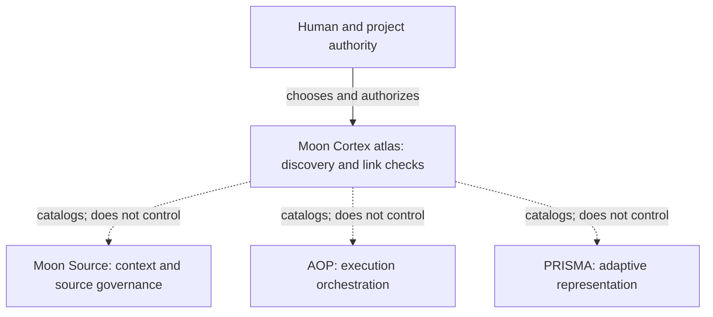

<!-- SPDX-FileCopyrightText: 2026 Lua Helena Moon Martins Cardoso (Moon) -->
<!-- SPDX-License-Identifier: CC-BY-4.0 -->

# Moon Cortex · Federation Atlas

**Find the right architecture. Keep each source in charge of its own domain.**

Moon Cortex has two distinct public surfaces. The **Moon-Cortex repository** continues to host five applied domain systems. The **Moon Cortex atlas** maps how those systems relate to independent public architectures and checks cross-repository routes. The atlas does not move, copy, install or govern its siblings.

[Português (Brasil)](ECOSYSTEM.pt-BR.md) · [Applied systems](README.md#choose-a-module) · [Architecture](ARCHITECTURE.md) · [Registry](registry/ecosystem.json) · [Compatibility contract](docs/CROSS_REPOSITORY_COMPATIBILITY.md)

## The federation at a glance



A dotted line means **discovery only**. It does not mean an installed dependency, common runtime, permission grant or transfer of authority. [PRISMA](https://github.com/luahelenammc/PRISMA) is an independent public release candidate, verified at its own repository and release.

## Choose by the work in front of you

| If you need to… | Start with… | Governing boundary |
|---|---|---|
| Identify which context or source governs, preserve continuity, or plan a source change | [Moon Source](https://github.com/luahelenammc/Moon-Source) · [Source Operations](https://github.com/luahelenammc/Moon-Source/blob/main/docs/SOURCE_OPERATIONS.md) | Moon Source governs its context and source operations methods. |
| Route a task across available models, tools, execution surfaces or workers | [Adaptive Orchestration Protocol](https://github.com/luahelenammc/Adaptive-Orchestration-Protocol) · [AOP core](https://github.com/luahelenammc/Adaptive-Orchestration-Protocol/blob/main/ADAPTIVE_ORCHESTRATION_PROTOCOL.md) | AOP governs its orchestration method and release set. It does not create tool access. |
| Work on finance, social support, probability, images or music | [The five applied systems](README.md#choose-a-module) | Each module governs its own domain method; local facts and choices stay with the user or authorized project. |
| Adapt a task through perspectives or personas | [PRISMA](https://github.com/luahelenammc/PRISMA) · [Canonical method](https://github.com/luahelenammc/PRISMA/blob/main/PRISMA.md) · [Public RC and offline packages](https://github.com/luahelenammc/PRISMA/releases/tag/v0.1.0-rc.1) | PRISMA owns its method and releases; local sources and people retain authority. |
| Map relations or verify registered cross-repository routes | This atlas · [registry](registry/ecosystem.json) · [route contract](docs/CROSS_REPOSITORY_COMPATIBILITY.md) | The atlas governs its index and route checks only. |

The five applied systems retain their existing identities, first-use paths and complete ZIP fallbacks. See [Choose a module](README.md#choose-a-module) for the current entry points.

## What each layer owns

| Layer | Owns | Does not own |
|---|---|---|
| **Moon Cortex atlas** | Public discovery metadata, relationship maps and an opt-in contract for checking links between repositories | The semantic authority, runtime, release process or private data of any indexed project |
| **Moon-Cortex repository** | Five applied domain systems, their public interfaces, packages, tests and evidence boundaries | A universal runtime or Moon Source's independent method body |
| **Moon Source** | Context governance, source authority, freshness, provenance, mutation and succession methods | AOP's current release or PRISMA's independent method or releases |
| **AOP** | Model-neutral routing and orchestration behavior, adapters and release packages | Tool availability, project truth or another project's decision authority |
| **PRISMA** | Source-governed perspectives, labeled simulation and structured contrast | Local truth, canon, decisions, independent-agent claims or source authority |
| **Human or governing project** | Consent, permissions, local facts, domain canon, decisions and persistence | The atlas cannot infer or take these powers |

A relationship in the catalog is not a dependency. A project may use its own method, decline a listed method or combine methods under its own rules.

## Public snapshot

The registry is a dated index, not a live service. The PRISMA public release candidate was verified on **2026-11-23** at commit `3c638f3d6b042619eacf6b26851fc0097bb20944`; [validation](https://github.com/luahelenammc/PRISMA/actions/runs/45286808563) passed. Other observed repository commits remain in the [registry](registry/ecosystem.json).

The atlas lists public projects only. Private project sources and unpublished material do not enter the public registry.

## Keeping routes useful

When an opted-in repository changes a public route, use the [cross-repository compatibility contract](docs/CROSS_REPOSITORY_COMPATIBILITY.md). It adopts the source-succession principles in [Moon Source · Source Operations](https://github.com/luahelenammc/Moon-Source/blob/main/docs/SOURCE_OPERATIONS.md) and [Archive and Legacy](https://github.com/luahelenammc/Moon-Source/tree/main/archive), while keeping route inventory and validation within this atlas. GitHub Markdown paths use readable pointers where needed; binary ZIPs remain real packages; HTTP redirects are claimed only when a hosting layer proves them.

Run the offline checks from the repository root:

```bash
python scripts/check_ecosystem_links.py
python -m unittest discover -s tests -v
```

Optional live checks use `python scripts/check_ecosystem_links.py --online`. A failed host or rate limit is reported as **unverified**, never as a passing link. See [registry governance](docs/ECOSYSTEM_GOVERNANCE.md) for how this map is maintained.

<!-- MOON-CORTEX-PUBLIC-STAMP -->

---

> 🌙 **Moon Cortex** · created by **Lua Helena Moon Martins Cardoso (Moon)** with AI-assisted coauthorial development by **Áurion** · [Licensing](LICENSING.md) · [Moon Source](https://github.com/luahelenammc/Moon-Source) · Questions, suggestions, or proposals? See the [repository README](README.md).
