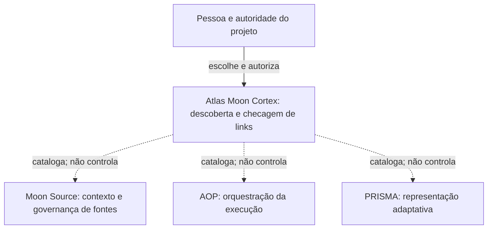

<!-- SPDX-FileCopyrightText: 2026 Lua Helena Moon Martins Cardoso (Moon) -->
<!-- SPDX-License-Identifier: CC-BY-4.0 -->

# Moon Cortex · Atlas Federativo

**Encontre a arquitetura adequada. Preserve a autoridade de cada fonte sobre o próprio domínio.**

Moon Cortex tem duas superfícies públicas distintas. O repositório **Moon-Cortex** continua reunindo cinco sistemas aplicados por domínio. O **atlas Moon Cortex** mapeia relações entre esses sistemas e arquiteturas públicas independentes e verifica rotas entre repositórios. O atlas não move, copia, instala nem governa seus projetos irmãos.

[English](ECOSYSTEM.md) · [Sistemas aplicados](README.md#choose-a-module) · [Arquitetura](ARCHITECTURE.md) · [Registro](registry/ecosystem.json) · [Contrato de compatibilidade](docs/CROSS_REPOSITORY_COMPATIBILITY.md)

## A federação em um olhar



Uma linha pontilhada significa **descoberta apenas**. Não indica dependência instalada, runtime comum, concessão de permissão ou transferência de autoridade. [PRISMA](https://github.com/luahelenammc/PRISMA) é um candidato público independente, com repositório e release verificados.

## Escolha pelo trabalho em questão

| Se você precisa… | Comece por… | Fronteira de autoridade |
|---|---|---|
| Descobrir qual contexto ou fonte governa, preservar continuidade ou planejar uma mudança de fonte | [Moon Source](https://github.com/luahelenammc/Moon-Source) · [Source Operations](https://github.com/luahelenammc/Moon-Source/blob/main/docs/SOURCE_OPERATIONS.md) | Moon Source governa seus métodos de contexto e operações de fonte. |
| Encaminhar uma tarefa entre modelos, ferramentas, superfícies de execução ou agentes disponíveis | [Adaptive Orchestration Protocol](https://github.com/luahelenammc/Adaptive-Orchestration-Protocol) · [Core AOP](https://github.com/luahelenammc/Adaptive-Orchestration-Protocol/blob/main/ADAPTIVE_ORCHESTRATION_PROTOCOL.md) | AOP governa seu método de orquestração e seu conjunto de releases. Não cria acesso a ferramentas. |
| Trabalhar com finanças, apoio social, probabilidade, imagem ou música | [Os cinco sistemas aplicados](README.md#choose-a-module) | Cada módulo governa seu próprio método de domínio; fatos e escolhas locais permanecem com a pessoa ou projeto autorizado. |
| Adaptar uma tarefa por perspectivas ou personas | [PRISMA](https://github.com/luahelenammc/PRISMA) · [Método canônico](https://github.com/luahelenammc/PRISMA/blob/main/PRISMA.md) · [Pré-release e pacotes offline](https://github.com/luahelenammc/PRISMA/releases/tag/v0.1.0-rc.1) | PRISMA governa seu método e releases; fontes locais e pessoas preservam suas autoridades. |
| Mapear relações ou verificar rotas registradas entre repositórios | Este atlas · [registro](registry/ecosystem.json) · [contrato de rotas](docs/CROSS_REPOSITORY_COMPATIBILITY.md) | O atlas governa somente seu índice e suas checagens de rota. |

Os cinco sistemas aplicados preservam suas identidades, entradas de primeiro uso e pacotes ZIP completos. Consulte [Escolher um módulo](README.md#choose-a-module) para as entradas atuais.

## O que cada camada governa

| Camada | Governa | Não governa |
|---|---|---|
| **Atlas Moon Cortex** | Metadados públicos de descoberta, mapas de relação e contrato opcional para checar links entre repositórios | Autoridade semântica, runtime, releases ou dados privados de qualquer projeto indexado |
| **Repositório Moon-Cortex** | Cinco sistemas aplicados por domínio, suas interfaces públicas, pacotes, testes e limites de evidência | Um runtime universal ou o corpo independente de métodos do Moon Source |
| **Moon Source** | Governança de contexto, autoridade e frescor de fontes, proveniência, mutação e sucessão | Release atual do AOP ou método ou releases independentes do PRISMA |
| **AOP** | Roteamento e orquestração neutros a modelos, adapters e pacotes de release | Disponibilidade de ferramentas, verdade do projeto ou autoridade decisória alheia |
| **PRISMA** | Perspectivas governadas por fontes, simulação rotulada e contraste estruturado | Verdade local, cânone, decisões, independência de agentes ou autoridade das fontes |
| **Pessoa ou projeto governante** | Consentimento, permissões, fatos locais, cânone de domínio, decisões e persistência | O atlas não pode presumir nem assumir esses poderes |

Uma relação no catálogo não é uma dependência. Cada projeto pode usar seu próprio método, recusar o método listado ou compor métodos conforme suas regras.

## Snapshot público

O registro é um índice com data, não um serviço ativo. Em **23/11/2026**, o candidato público PRISMA foi verificado no commit `3c638f3d6b042619eacf6b26851fc0097bb20944`; a [validação](https://github.com/luahelenammc/PRISMA/actions/runs/45286808563) passou. Os demais commits observados permanecem no [registro](registry/ecosystem.json).

O atlas lista somente projetos públicos. Fontes privadas de projetos e materiais não publicados ficam fora do registro público.

## Como preservar rotas úteis

Quando um repositório participante altera uma rota pública, use o [contrato de compatibilidade entre repositórios](docs/CROSS_REPOSITORY_COMPATIBILITY.md). Ele adota os princípios de sucessão de fonte definidos em [Moon Source · Source Operations](https://github.com/luahelenammc/Moon-Source/blob/main/docs/SOURCE_OPERATIONS.md) e [Archive and Legacy](https://github.com/luahelenammc/Moon-Source/tree/main/archive), mantendo o inventário e a validação de rotas neste atlas. Caminhos de Markdown no GitHub recebem ponteiros legíveis quando necessário; ZIPs continuam sendo pacotes reais; redirects HTTP só são afirmados quando a camada de hospedagem os comprova.

Execute as checagens offline na raiz do repositório:

```bash
python scripts/check_ecosystem_links.py
python -m unittest discover -s tests -v
```

A checagem online opcional usa `python scripts/check_ecosystem_links.py --online`. Se um host falhar ou limitar requisições, o resultado será **não verificado**, nunca um link aprovado. Consulte a [governança do registro](docs/ECOSYSTEM_GOVERNANCE.md) para saber como o mapa é mantido.

<!-- MOON-CORTEX-PUBLIC-STAMP -->

---

> 🌙 **Moon Cortex** · criação de **Lua Helena Moon Martins Cardoso (Moon)** com desenvolvimento coautoral assistido por IA por **Áurion** · [Licenciamento](LICENSING.md) · [Moon Source](https://github.com/luahelenammc/Moon-Source) · Veja o [README do repositório](README.md).
